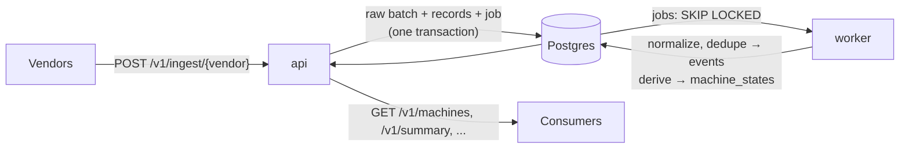

# Equipment Monitoring Service

A backend service that ingests machine data from three vendors (PulseForge,
ThermexWatch, MaintaFlow) plus internal maintenance work orders, normalizes it into one
canonical event shape, processes it in the background, and serves a per-machine
"attention" view and a plant/line summary.

## Stack

Python 3.12, FastAPI, PostgreSQL 16, SQLAlchemy 2 + Alembic, pytest, Docker Compose.

## Running locally

Requires Docker.

```bash
docker compose up --build
```

- API: http://localhost:8000
- OpenAPI docs: http://localhost:8000/docs
- Health check: http://localhost:8000/health

This starts three containers: `db` (Postgres 16), `api` (runs migrations, loads reference
data, serves HTTP) and `worker` (processes the job queue). `api` and `worker` share one
image.

## Loading the provided data

With the stack running, load every seed CSV and every vendor sample through the public
ingest API:

```bash
python scripts/seed.py
```

The script needs only the Python 3.12 standard library, so no virtualenv is required. It
posts 21 batches, waits for the worker, and prints the attention view:

```
machine  line    status             lvl  reasons
EQ-002   LINE-A  CRITICAL             4  TEMPERATURE_ALERT, TEMPERATURE_ABOVE_RATED, MAINTENANCE_OVERDUE, OPEN_WORK_ORDER
EQ-005   LINE-D  WARNING              3  VIBRATION_ABOVE_RATED, VIBRATION_ALERT, INSPECTION_OBSERVATION, MAINTENANCE_DUE_SOON
EQ-008   LINE-E  WARNING              3  INSPECTION_MAJOR_DEFECT, UNMAPPED_VENDOR_ALERT, OPEN_WORK_ORDER
EQ-001   LINE-A  WATCH                1  INSPECTION_MINOR_DEFECT
EQ-007   LINE-E  UNDER_MAINTENANCE    1  CALIBRATION_PENDING, OPEN_WORK_ORDER, ASSET_IN_MAINTENANCE, INACTIVE_WITH_OPEN_WORK_ORDER
EQ-003   LINE-B  NORMAL               0
EQ-004   LINE-C  NORMAL               0
EQ-006   LINE-D  NORMAL               0
```

- **Options:** `--seed-only` loads just the CSVs. `--base-url` points the script at
  another server.
- **Without local Python:** run it inside the stack instead:
  `docker compose run --rm api python scripts/seed.py --base-url http://api:8000`.
- **Re-running is safe:** every batch has a fixed `Idempotency-Key`, so a second run
  changes nothing and reports each batch as "already ingested".
- **Starting over:** `docker compose down -v` deletes the database volume.

Then open the dashboard at **http://localhost:8000/dashboard**, or explore the API directly:

```bash
curl localhost:8000/v1/summary
curl localhost:8000/v1/machines/EQ-008
curl "localhost:8000/v1/machines?needs_attention=true"
curl localhost:8000/v1/machines/EQ-001/events
```

With a real clock every machine reads `"freshness": "STALE"`, because the sample data is
from 2026-04-18. Freshness is computed against the current time, and tests pin the clock.

### Dashboard

`/dashboard` is one static, read-only HTML page (`app/static/dashboard.html`). It uses
plain JavaScript and only the public read APIs, with no build step, framework or external
resources. It shows:
- status counts;
- machines, most urgent first;
- lines ranked by machines needing attention;
- processing health;
- for a clicked machine, its reasons with their source records and its latest events.

It has a plant filter and refreshes every 15 seconds. All vendor-supplied text is inserted
as text, never as HTML, so a malicious technician note can't inject script. It is excluded
from the OpenAPI contract.

## Running tests

Inside Docker (no local Python needed):

```bash
docker compose run --rm api pytest
```

Or with a local Python 3.12 virtualenv (Postgres still comes from compose):

```bash
docker compose up -d db
python -m venv .venv
.venv/Scripts/activate    # Windows; use `source .venv/bin/activate` on macOS/Linux
pip install -e ".[dev]"
pytest
```

Integration tests use a separate `equipment_test` database on the same Postgres server
(created automatically, rebuilt from the migrations once per run, truncated after each
test). Override it with `TEST_DATABASE_URL`.

On startup the `api` container runs `alembic upgrade head` and then loads the reference
CSVs (`python -m app.reference_data`). Both steps are idempotent.

## Repository layout

| Path | Purpose |
|---|---|
| `app/` | Service code (API, normalization, jobs, derivation) |
| `app/static/dashboard.html` | Optional read-only dashboard served at `/dashboard` |
| `alembic/` | Database migrations |
| `scripts/seed.py` | Loads the provided data through the ingest API |
| `tests/` | Unit and integration tests |
| `data/` | The provided assessment assets (reference CSVs, seed CSVs, vendor samples) |
| `docs/` | [Architecture](docs/architecture.md), [design note](docs/design-note.md), [OpenAPI contract](docs/openapi.json) |

## Architecture



- **api** (FastAPI) accepts batches and serves read endpoints. It does no heavy work.
- **worker** runs two kinds of job:
  - `normalize_batch`: validate, normalize and dedupe every record of a batch;
  - `recompute_machine`: re-derive one machine's state from all its events.
- **Postgres** holds the raw data, canonical events, derived states and the job queue,
  so there is no extra infrastructure.

More detail, with a batch lifecycle sequence diagram, is in
[docs/architecture.md](docs/architecture.md). The reasoning behind the main decisions is
in [docs/design-note.md](docs/design-note.md).

### Data model

| Table | Holds |
|---|---|
| `lines`, `machines` | Reference data from `line_reference.csv` / `asset_reference.csv` (rated limits, asset status) |
| `ingestion_batches` | Every accepted POST, stored verbatim, with its idempotency key and processing counts |
| `raw_records` | One row per record in a batch: `pending` / `accepted` / `rejected` / `duplicate`, plus reason codes |
| `events` | Canonical normalized events (UTC, Celsius, 0-4 severity), linked back to their raw record |
| `machine_states` | The derived attention view per machine, rebuilt from `events` |
| `jobs` | Postgres-backed job queue; `status = 'dead'` is the dead-letter list |

Data flows one way: raw → events → machine_states. Raw data is never modified, so any
derived table can be rebuilt from the layer below it.

## API

Full contract: [docs/openapi.json](docs/openapi.json), also served live with Swagger UI at
http://localhost:8000/docs. A test fails if the committed file drifts from the code;
regenerate it with `python -m scripts.export_openapi`.

### Ingestion

`POST /v1/ingest/{vendor}` where `vendor` is `pulseforge`, `thermexwatch`, `maintaflow`
or `workorders`. The body is the vendor's own batch format.

| Header | |
|---|---|
| `X-API-Key` | Required. One key per vendor (`API_KEY_<VENDOR>` env vars; dev defaults like `dev-pulseforge-key`). |
| `Idempotency-Key` | Optional, up to 128 chars. If omitted, the SHA-256 of the canonical JSON body is used. |

```bash
curl -X POST localhost:8000/v1/ingest/thermexwatch \
  -H "X-API-Key: dev-thermexwatch-key" -H "Content-Type: application/json" \
  --data @data/vendor_api_samples/thermexwatch_sample.json
```

| Response | When |
|---|---|
| `202` + `ingestion_id`, `status_url` | Batch stored and queued (also on an idempotent retry, with `idempotent_replay: true`) |
| `401` | Missing key, or another vendor's key |
| `409` | `Idempotency-Key` already used for a different body |
| `413` | More than `MAX_RECORDS_PER_BATCH` records (default 1000) |
| `422` | Body is not a JSON object, the record list is missing/empty/not a list, or the envelope names a different vendor |

### Processing status

| Endpoint | Returns |
|---|---|
| `GET /v1/ingestions/{id}` | Batch status (`queued` / `completed` / `failed`), counts (accepted, rejected, duplicate, pending), last error, and its job (attempts, next retry time) |
| `GET /v1/ingestions/{id}/records?status=rejected` | Each record's outcome, reason codes, the event it created or duplicates, and the raw record as sent. Paginated with `limit` / `offset` |

### Machine attention view

| Endpoint | Returns |
|---|---|
| `GET /v1/machines` | Every machine in the reference data, most urgent first. Filters: `plant_id`, `line_id`, `status`, `needs_attention` |
| `GET /v1/machines/{machine_id}` | One machine's view (below) |
| `GET /v1/machines/{machine_id}/events` | Its normalized events, newest event time first, each with `ingestion_id`, `raw_record_id`, quality flags and vendor attributes |

A machine view carries the fields `expected_output_context.md` asks for:

```json
{
  "machine_id": "EQ-002", "plant_id": "PLANT_01", "line_id": "LINE-A",
  "derived_status": "CRITICAL", "needs_attention": true, "attention_level": 4,
  "reason_codes": ["TEMPERATURE_ALERT", "TEMPERATURE_ABOVE_RATED", "MAINTENANCE_OVERDUE", "OPEN_WORK_ORDER"],
  "reasons": [{"code": "TEMPERATURE_ALERT", "severity": 4, "dimension": "temperature",
               "message": "thermexwatch reported TEMP_CRIT (severity 4)", "confidence": null,
               "source_event_refs": [{"event_id": 12, "vendor": "thermexwatch", "source_record_id": "TW-8803", "...": "..."}]}],
  "latest_relevant_event_time": "2026-04-18T08:49:00Z",
  "freshness": "FRESH", "processing_status": "UP_TO_DATE",
  "last_processed_at": "...", "source_event_refs": ["..."]
}
```

- `processing_status` comes from the machine's latest recompute job:
  - `PENDING`: a recompute is queued or running;
  - `FAILED`: the last recompute was dead-lettered;
  - `NO_DATA`: no events yet;
  - otherwise `UP_TO_DATE`.
- A machine with no events yet is listed as `UNKNOWN`, not left out.

### Plant / line summary

`GET /v1/summary?plant_id=PLANT_01` (omit `plant_id` for all plants) answers the
questions in `expected_output_context.md`:

| Question | Field |
|---|---|
| How many machines are in each status? | `status_counts`, per plant in `plants[]`, per line in `lines[]` |
| Which lines have the most machines needing attention? | `lines[]`, sorted by `needs_attention_count`, then highest attention level |
| Which machines are critical? | `critical_machines[]` with reason codes |
| Any stale, failed or partially processed state? | `processing`: stale / pending / failed / no-data machines, ingestions by status, batches with rejected records, dead-letter count |

### Dead letters

| Endpoint | |
|---|---|
| `GET /v1/dead-letters?kind=` | Dead jobs, newest first, with payload and last error |
| `POST /v1/dead-letters/{job_id}/replay` | Re-queue a dead job with fresh attempts (`202`). Needs the operations key (`X-API-Key: dev-ops-key`, set with `API_KEY_OPS`). Returns `409` if the job isn't dead or an equivalent job is already queued |

Replaying a dead `normalize_batch` sets its batch back to `queued`; its raw records were
kept `pending`, so they are processed from scratch.

## Assumptions

Each assumption is recorded when the code that depends on it is written.

### Repository
- The provided assets are kept unchanged under `data/`, with the doubled
  `Aurik_Tech_Lead_Assessment_Assets/Aurik_Tech_Lead_Assessment_Assets/` folder
  flattened. The candidate brief PDF is not committed.
- `data/asset_reference.csv` and `data/seed_data/asset_reference.csv` are byte-identical
  (same for `line_reference.csv`); the top-level copies are treated as the source of truth.

### Data observations
- Vendor sample files that combine several vendors (`happy_path.json`, `duplicates.json`,
  `malformed.json`, `out_of_order.json`, `conflicting_updates.json`, `retry_cases.json`)
  are keyed by vendor. Tests and the seed script split them and send each part to its own
  vendor endpoint, because ingestion is per vendor.
- `maintenance_work_orders.csv` belongs to no vendor. It is treated as a fourth source,
  `workorders` (an internal maintenance system).

### Schema
- `asset_reference.csv` and `line_reference.csv` are the source of truth for which
  machines and lines exist, their plant/line, and their rated limits.
- Enum-like columns (vendor, statuses) are `VARCHAR` + `CHECK` constraints rather than
  native Postgres enums, so adding a value is a one-line migration.
- Freshness (FRESH/STALE) is not stored, because it depends on the current time; it is
  computed when the machine view is read.
- A single `jobs` table doubles as the dead-letter store (`status = 'dead'`); a separate
  table would add a copy step without adding information.
- At most one *queued* job per `dedupe_key` (a partial unique index), so many new
  events for one machine collapse into a single pending recompute.

### Ingestion
- The API checks only the batch envelope; each record is validated by the worker. One bad
  record never rejects a batch, and a batch is never half-stored.
- The batch, its raw records and the `normalize_batch` job are written in one transaction,
  so an accepted batch can't lose its job.
- Record lists live under `events` (PulseForge), `readings` (ThermexWatch), `records`
  (MaintaFlow) and `work_orders` (work orders). The work-order envelope is my own choice,
  since the source only came as a CSV.
- If the envelope names its sender (`vendor` / `source` / `provider_name`), it must match
  the URL. Envelopes without it are accepted.
- Idempotency keys are scoped per vendor. The fallback key hashes *canonical* JSON (sorted
  keys, no whitespace), so a re-serialized identical body still counts as a retry.
  A replay returns the same `202` body with `idempotent_replay: true`, so client retry
  logic needs no special case.
- Batch-level idempotency is separate from record-level dedupe: two different batches that
  contain the same record are both stored, and the duplicate record is caught during
  normalization.
- Versioning: the URL carries the API version (`/v1`). Vendor payloads carry no schema
  version, so the current sample formats are assumed; raw payloads are kept, so batches can
  be reprocessed if a vendor format changes.
- API keys are static per vendor and come from environment variables. In production they
  would come from a secrets manager and support rotation (two valid keys at once).

### Normalization
One pure normalizer per source (`app/normalization/`): raw record + batch envelope +
reference data in, either a canonical event or a list of reject reasons out. The seed CSVs
go through the same normalizers; field aliases cover the different spellings
(ThermexWatch `readingId` in JSON vs `reading_id` in CSV).

| | PulseForge | ThermexWatch | MaintaFlow | Work orders |
|---|---|---|---|---|
| Time | ISO-8601 with offset → UTC | epoch ms (UTC) | `2026/04/18 08:14:05` in `MAINTAFLOW_TIMEZONE` (default UTC) | `closed_at` if closed, else `opened_at` |
| Temperature | °C | °F → °C (2 dp) | – | – |
| Vibration | mm/s | g, stored as-is | – | – |
| Severity (0-4) | low/medium/high/critical → 1/2/3/4 | level 1-5 → 0-4 | none | none |
| Confidence | `vendor_confidence` 0-1 | – | `manual_confidence` high/medium/low → 0.9/0.6/0.3 | – |

**Reject vs flag.** A record is rejected (kept in `raw_records` with reason codes) only
when it can't be placed on a machine timeline: missing record id, missing machine id,
machine not in `asset_reference.csv`, or a missing/unparseable/zone-less event time. Any
other problem keeps the record and adds a quality flag:
- bad optional value → stored as null, flagged `INVALID_<FIELD>` or `<FIELD>_OUT_OF_RANGE`
  (e.g. `temperature_c: -999`, `sensor_health: "bad"`, `vendor_confidence: 1.2`);
- unknown code → canonical value null (or event type `unknown`), raw value kept in
  `attributes`, flagged `UNKNOWN_<FIELD>` (e.g. severity `urgent`, alert `UNKNOWN_ALERT`).

**Other choices**
- Vendor codes are mapped to vendor-neutral event types (`HIGH_VIBRATION` and `VIB_WARN` →
  `vibration_alert`; `TEMP_SPIKE`, `TEMP_WARN`, `TEMP_CRIT` → `temperature_alert`, told
  apart by severity). The vendor's code is always kept in `attributes.vendor_event_type`.
- Plant and line come from `asset_reference.csv`. A vendor value that disagrees is flagged
  (`PLANT_MISMATCH`, `LINE_MISMATCH`) and kept in `attributes`. Short line ids are expanded
  (`A` → `LINE-A`).
- A timestamp without a timezone (`2026-04-18T07:59:12`) is rejected for the ISO-based
  vendors rather than guessed. MaintaFlow is the exception: its format never has a zone,
  so a configured zone is applied.
- `18-04-2026 08:28:20` (PF-1202) is rejected, not reinterpreted as day-month-year, because
  PulseForge's documented format is ISO-8601 and a guess could silently misplace an event.
- ThermexWatch vibration in g is not converted to mm/s: that needs the vibration frequency,
  which isn't sent. Rated vibration limits (mm/s) therefore apply only to PulseForge readings.
- MaintaFlow `maintenance_status: "unknown"` means "no information" and is stored as null
  without a flag.
- Epoch-ms values outside 2000-2100 are treated as invalid.
- Each work-order state is its own event with id `<work_order_id>:<status>`, so the
  open → closed update isn't discarded as a duplicate. A closed order with no `closed_at`
  falls back to `opened_at` and is flagged `MISSING_CLOSED_AT`.
- The content hash covers what was observed (machine, time, type, readings, codes), not the
  record id or arrival time. So `TW-8801-R` hashes the same as `TW-8801`, and a reading
  arriving via CSV hashes the same as via JSON.

### Background processing
The `worker` container (`python -m app.jobs.worker`) polls the `jobs` table.

- **Claiming:** `SELECT ... FOR UPDATE SKIP LOCKED` takes the oldest due job, so any number
  of workers can run side by side without handing out a job twice.
- **Transactions:** the claim is committed on its own. The handler's work and "mark
  succeeded" are then committed together, so a failed attempt is rolled back completely:
  no half-normalized batch.
- **Failures:**
  - `PermanentError` (e.g. the batch doesn't exist, or the job kind is unknown) → dead at once.
  - `TransientError` or any unexpected exception → retried after 2s, 4s, 8s, 16s (capped at
    5 min). After the 5th attempt the job is dead.
  - A dead `normalize_batch` marks its batch `failed`, with the last error. Its raw records
    stay `pending`, so it can be replayed once the cause is fixed.
- **Crash recovery:** a job left `running` longer than `JOB_LOCK_TIMEOUT_SECONDS` (5 min) is
  assumed lost and re-queued, or dead-lettered if it is out of attempts. Processing is
  therefore at-least-once, and handlers are safe to re-run: a completed batch is skipped.
- **Dedupe** (per vendor only, never across vendors):
  1. same vendor + record id → `duplicate` with `DUPLICATE_RECORD_ID`;
  2. otherwise same vendor + content hash → `duplicate` with `DUPLICATE_CONTENT`.

  A duplicate raw record links to the event it duplicates. Records within one batch are
  checked against each other too (PF-1001 twice in `duplicates.json`).
- **Record ids are immutable:** if a vendor re-sends an id with *different* content, the
  first version is kept and the new copy is marked `DUPLICATE_RECORD_ID` + `CONTENT_DIFFERS`
  for review. It is not applied, because a silently overwritten reading can't be audited.
- **One clock for the queue:** all queue timing (is a job due, backoff, stale locks) uses
  the database's `now()`, never a worker's clock. Workers on different hosts can't disagree
  about whether a job is due. (The first version mixed both clocks; Windows' ~15 ms clock
  granularity made a just-created job look "not due yet", which a test caught.)
- **Recompute jobs:** after storing new events, `normalize_batch` queues one
  `recompute_machine` job per machine that got new events. The job uses a dedupe key, so
  while a recompute is still queued, further batches for that machine don't add another:
  21 batches in the full dataset need only 13 recomputes. Batches with only duplicates or
  rejections queue nothing.
- **Recompute locking:** a recompute locks the machine row first, so two recomputes of one
  machine run one after the other, and the later one always reads the newest events. An
  older result can never overwrite a newer one.

### Derived machine state
`app/derivation/rules.py` holds a pure function, `derive_state(machine, events)`. It
recomputes the state from *all* of the machine's events, sorted by event time (never by
arrival), so the same events always give the same result, whatever order they came in.
The golden tests run the full dataset forwards and backwards to show this.

**1. Each dimension uses only its latest evidence.** On a timestamp tie the more severe
event counts as later, to stay cautious.

| Dimension | Fed by | Severity (0-4) |
|---|---|---|
| Vibration | `vibration_mm_s`, `vibration_g` or a vibration alert | vendor severity if it is a vibration alert; **3** if mm/s > `rated_max_vibration_mm_s` |
| Temperature | `temperature_c` or a temperature alert | vendor severity if it is a temperature alert; **3** if > `rated_max_temp_c` |
| Power | `power_kw` or a power alert | vendor severity if it is a power alert; **2** if more than 30% away from `baseline_power_kw` |
| Sensor health | `sensor_health`, `signal_quality` or a sensor alert | vendor severity if it is a sensor alert; **2** if health < 0.6; **1** if signal `poor` |
| Unknown alert | latest event with an unrecognised code | **1** (worth a look; its level isn't trusted) |
| Inspection | `inspection_result` | major defect / failed **3**; minor defect, observation, calibration pending **1** |
| Maintenance | `maintenance_status` | overdue **2**; due soon **1** |
| Work orders | latest state of each work order | each still open **1** |

- A vendor's severity counts only for its own dimension: a `TEMP_SPIKE` with normal
  vibration doesn't raise vibration.
- A recovery or OK signal clears a dimension only through its readings. If those readings
  are still above the rated limit, the dimension stays raised.
- Operator notes are informational and don't change the status.

**2. Completed maintenance resets the machine.** A MaintaFlow `completed` record, or a work
order closed with `post_maintenance_check = passed`, clears all evidence older than itself,
except work orders that are still open. A closed work order whose check failed doesn't
reset anything.

**3. The status:**

| Status | When |
|---|---|
| `UNKNOWN` | no events yet |
| `CRITICAL` | any severity 4. This wins over maintenance. |
| `UNDER_MAINTENANCE` | `asset_status = maintenance`, or an open work order while the latest activity signal (`is_active`, else `machine_state == running`) says the machine isn't running |
| `WARNING` / `WATCH` / `NORMAL` | highest severity 3 / 1-2 / 0 |

- `attention_level` is the highest severity, and is still reported under maintenance.
- `needs_attention` is true only for WATCH, WARNING and CRITICAL.
- Every reason has a code, severity, dimension, message, confidence (manual or vendor) and
  the source events behind it. That way each status can be traced back to raw vendor records.
- **Freshness** (`FRESH` / `STALE`) is computed when the view is read, against an
  injectable clock: STALE if the latest event is older than `STALE_AFTER_MINUTES`
  (default 60). The sample data is from 2026-04-18, so with a real clock every machine
  shows STALE.

**Golden results** for the full dataset (all seed CSVs + all samples):

| Machine | Status | Why |
|---|---|---|
| EQ-001 | WATCH | PF-1302's recovery (08:32:05) is newer than PF-1301's alert (08:31:02), although it arrived first. MF-501's minor defect remains. |
| EQ-002 | CRITICAL | TW-8803 `TEMP_CRIT` level 5, 97 °C against a 90 °C rating |
| EQ-003 | NORMAL | only recovery and OK signals |
| EQ-004 | NORMAL | WO-1002 closed and passed (08:10), then MF-701 `completed` (08:40), clear the older power alerts |
| EQ-005 | WARNING | PF-1501 measures 8.8 mm/s against an 8.0 rating |
| EQ-006 | NORMAL | TW-9902 OK with good signal is newer than PF-1006's sensor-health drop |
| EQ-007 | UNDER_MAINTENANCE | asset status is `maintenance`; WO-1004 is open and the machine is inactive |
| EQ-008 | WARNING | PF-1401's recovery is newer than TW-9921's `TEMP_CRIT`, but MF-801 (08:41) still reports a major defect and WO-1003 is open |

**Deliberate simplifications**
- Exceeding a rated limit gives WARNING, never CRITICAL on its own; CRITICAL needs a vendor
  critical alert.
- Confidence (vendor or manual) is shown on each reason but doesn't scale its severity.
- Thresholds are constants in `rules.py`. Per-machine-type thresholds would be the next step.
- Changing `asset_reference.csv` doesn't trigger recomputes. They happen when new events
  arrive.

### Read APIs
- Read endpoints have no authentication: they are assumed to sit on an internal network
  behind a gateway. Only dead-letter replay, which changes processing state, needs a key.
  In production all of it would go behind the platform's auth (SSO / service tokens).
- The machine list and summary read every machine at once (8 here). With thousands of
  machines they would need pagination, and the summary would be computed with SQL `GROUP BY`
  or a materialised table rather than in Python.
- Ingestion counts in the summary cover all plants: a batch's plant isn't known reliably
  until its records are normalized.
- A batch has no `processing` status: it is normalized in one transaction, so it goes
  straight from `queued` to `completed` or `failed`. Migration 0002 removed the unused value.
  Retry progress is reported through the batch's job (`attempts`, `next_attempt_at`).

## Trade-offs

| Choice | Gained | Gave up |
|---|---|---|
| Postgres as the job queue | No extra infrastructure. Jobs commit atomically with their data. Easy to inspect with SQL | Throughput of a real broker; workers poll instead of being pushed work |
| Store raw first, validate in the worker | A bad record never sinks a batch; nothing is lost; batches can be re-processed | A vendor learns about rejected records from the status endpoint, not the POST response |
| Recompute a machine from all its events | Correct under out-of-order and late data by construction; simple to test | More work per recompute than an incremental update |
| Latest evidence per dimension | Explainable: each reason points at one event | Ignores trends, e.g. three warnings in a row |
| First version wins for a re-sent record id | Auditable; nothing is silently overwritten | A genuine vendor correction needs a manual step |
| ThermexWatch vibration kept in g | No invented numbers | Its vibration can't be compared with rated mm/s limits |
| Open read endpoints | Simple to explore and integrate | Needs a gateway or auth before leaving an internal network |

## Limitations

- **Thresholds:** they are code constants, the same for every machine type.
- **Reference data:** `asset_reference.csv` is loaded at startup. Changing it doesn't
  trigger recomputes.
- **Freshness:** the stale threshold is one global value; it doesn't take a line's
  operating window (`day_shift`, `24x7`) into account.
- **Scale:** the machine list and summary load all machines at once, with no pagination.
- **Vendor correction protocol:** none. A re-sent id with different content is flagged
  `CONTENT_DIFFERS`, not applied.
- **Content-hash race:** two workers processing the same re-sent content at the same moment
  could both store it. A database constraint covers duplicate record *ids*, not content.
- **Operations:** there are no metrics or tracing. Logs are plain text.

## What I would do next for production

1. **Observability:** structured JSON logs with ingestion and job ids; metrics for queue
   depth, job latency, retries, dead letters and rejection rate per vendor; alerts on
   dead letters and stale machines.
2. **Security:** per-vendor keys from a secrets manager with rotation, auth on the read
   APIs, request size limits and rate limiting at the gateway.
3. **Rules as data:** thresholds per machine type, versioned, with each machine state
   recording the rule version that produced it.
4. **Recompute on reference changes:** re-derive affected machines when asset or line data
   changes, and make freshness use the line's operating window.
5. **Queue at scale:** `LISTEN/NOTIFY` to wake workers, archiving of finished jobs, and a
   partial unique index on content hash per vendor.
6. **Data lifecycle:** retention and partitioning for raw records and events, plus a
   backfill command to re-normalize stored raw data after a normalizer fix.
7. **Delivery:** CI running the test suite and a migration check, and separate
   dependency sets for the production and test images.

## AI usage disclosure

- **Tool:** Claude Code (Anthropic) was used as a pair-programming assistant throughout.
- **My decisions, set before any code was written:**
  - the stack (Python 3.12, FastAPI, Postgres 16, SQLAlchemy/Alembic, pytest, Docker
    Compose with db/api/worker);
  - a Postgres-backed job queue with retries, backoff, dead letters and
    permanent/transient errors, instead of Kafka/Redis/Celery;
  - the ingestion design: per-vendor keys, idempotency keys, raw storage, validation in
    the worker;
  - the normalization rules: UTC, Celsius, the 0-4 severity mapping, separate manual
    confidence, no g → mm/s conversion, reject vs flag;
  - the dedupe rules;
  - derived state as a pure function over all events, ordered by event time;
  - the status set;
  - the golden cases the tests had to prove.
- **How the work went:** step by step (scaffold → schema → ingestion → normalizers →
  worker → derivation → read APIs → seed script → docs), with my review and approval
  before each commit.
  - I approved the open design choices the assistant raised, including the work-order
    source and the `UNDER_MAINTENANCE` precedence.
  - I approved the full derivation rule set before it was implemented.
- **What the assistant did:** it read the brief and data, proposed the plan and the rules,
  wrote the code, tests and documentation, and ran the tests and the Docker stack after
  each step.
- **How I verified it:** by reviewing each step's explanation and diff, by the test suite
  (unit tests for the pure normalizers and rules, end-to-end golden tests through the real
  API and worker), and by running the stack locally.
