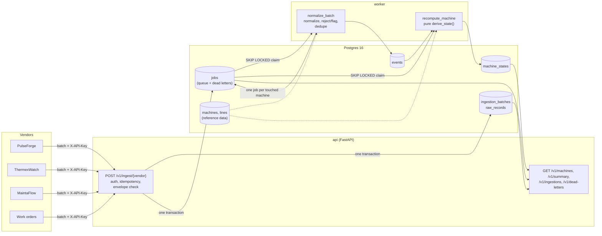
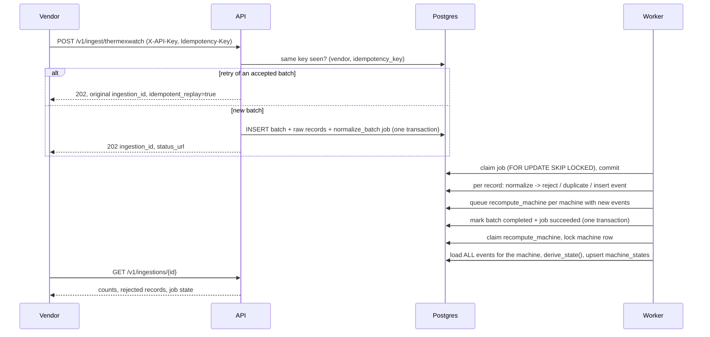
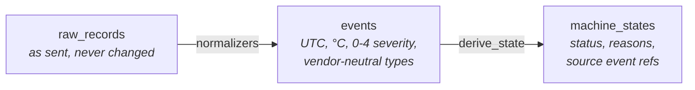

# Architecture

Three processes and one database. The API accepts and serves; the worker does everything
slow or failure-prone; Postgres holds the data, the queue and the derived views.

## Lifecycle of a batch

If any step in the worker raises, its transaction rolls back completely and the job is
retried with backoff (2s, 4s, 8s, 16s). After 5 attempts, or on a `PermanentError`, the
job is dead-lettered and can be replayed with `POST /v1/dead-letters/{id}/replay`.

## Data layers

Each layer is computed only from the layer before it. That gives three properties:

- **Traceable:** every reason in a machine view points to events, every event to its raw
  record, every raw record to its ingestion batch.
- **Rebuildable:** a fixed normalizer can re-run over stored raw records; a changed rule can
  recompute every machine from its events.
- **Order-independent:** `derive_state` reads *all* of a machine's events sorted by event
  time, so arrival order never matters (tested by ingesting the full dataset forwards and
  backwards).

## Code map

| Path | Responsibility |
|---|---|
| `app/api/` | HTTP layer only: auth, request parsing, status codes |
| `app/ingestion.py` | Envelope check, idempotency, storing a batch and its job |
| `app/normalization/` | One pure normalizer per source + shared parsing helpers |
| `app/jobs/` | Queue (claim, retry, dead-letter), handlers, worker loop |
| `app/derivation/rules.py` | Pure attention rules: events + machine → state |
| `app/derivation/service.py` | Loads events, runs the rules, stores the result |
| `app/views.py` | Read-side queries for machine views and the summary |
| `app/models.py` | Database schema (migrations in `alembic/`) |

The two pure modules, `normalization/` and `derivation/rules.py`, hold the business logic
and are unit-tested without a database. Everything around them is plumbing.
